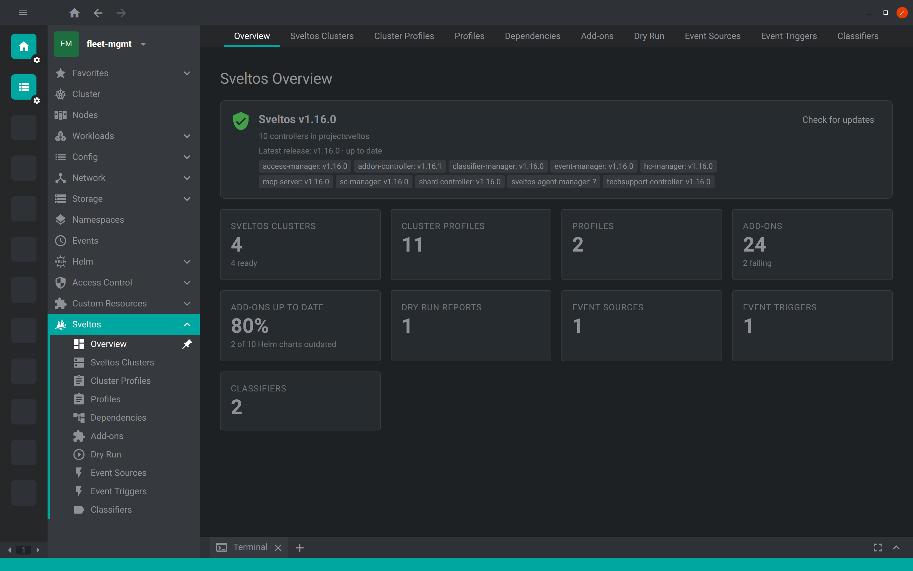
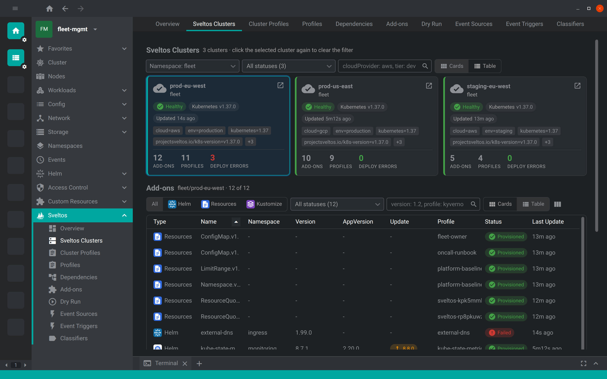
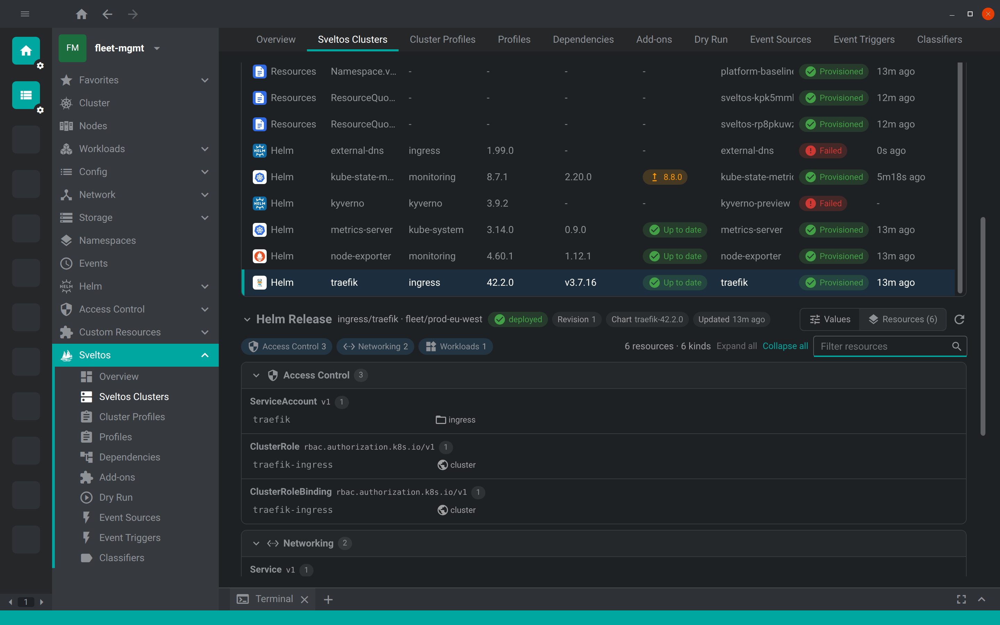
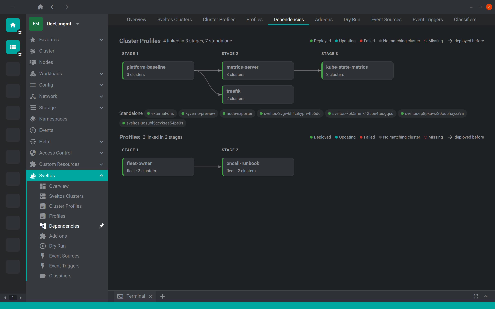

# @freelensapp/sveltos-extension

<!-- markdownlint-disable MD013 -->

[](https://freelens.app)
[](https://github.com/freelensapp/freelens-sveltos-extension)
[](https://deepwiki.com/freelensapp/freelens-sveltos-extension)
[](https://github.com/freelensapp/freelens-sveltos-extension/releases)
[](https://github.com/freelensapp/freelens-sveltos-extension/actions/workflows/unit-tests.yaml)
[](https://github.com/freelensapp/freelens-sveltos-extension/actions/workflows/integration-tests.yaml)
[](https://www.npmjs.com/package/@freelensapp/sveltos-extension)

<!-- markdownlint-enable MD013 -->

## Overview

[Freelens](https://freelens.app) extension for
[Sveltos](https://projectsveltos.io), the Kubernetes add-on controller that
deploys Helm charts, Kubernetes resources and Kustomize outputs across a fleet
of clusters. Modeled on the official
[Sveltos dashboard](https://github.com/projectsveltos/dashboard), it shows in
the Freelens desktop application the clusters of the fleet, the profiles that
target them, the add-ons deployed on each one and what went wrong.

The extension lives in the cluster sidebar under **Sveltos**: **Overview**,
**Sveltos Clusters** (the dashboard of the clusters and their add-ons, down to
the Helm release of an add-on), **Cluster Profiles**, **Profiles**,
**Dependencies**, **Add-ons**, **Dry Run**, **Event Sources**,
**Event Triggers** and **Classifiers**. The Sveltos resources are read from the
management cluster through the Freelens session that is already authenticated
to it. The Helm release of an add-on is read from the managed cluster, with the
kubeconfig Secret that Sveltos uses to reach it, and the latest Sveltos release
and the chart logos come from the internet (see
[Internet access](#internet-access)). In the cluster, the actions of the
extension write only to a `SveltosCluster`: pausing or resuming it and editing
its labels and annotations.

[Video Demo](https://github.com/user-attachments/assets/aa8c7b14-56bd-4bd9-b613-f142a5a35f53)









### Authors

- [Roberto Bandini](https://github.com/robertobandini) created the first
  version of this extension.
- [Alberto](https://github.com/albyrex) created the current version, a rewrite
  of the extension modeled on the official Sveltos dashboard, contributed in
  [#30](https://github.com/freelensapp/freelens-sveltos-extension/pull/30).
  This is the version ported to the extension API of Freelens 2.

## Requirements

- Freelens 2.0.0 or a later 2.x (extension API v2). Freelens 1.8 or a later
  1.x needs version 1.0.0, the first version of the extension.
- [Sveltos](https://projectsveltos.io/main/getting_started/install/install/)
  installed in the management cluster

## Supported APIs

<!-- markdownlint-disable MD013 -->

| API Version                      | Kind                   | Scope      |
| -------------------------------- | ---------------------- | ---------- |
| config.projectsveltos.io/v1beta1 | `ClusterProfile`       | Cluster    |
| config.projectsveltos.io/v1beta1 | `Profile`              | Namespaced |
| config.projectsveltos.io/v1beta1 | `ClusterSummary`       | Namespaced |
| config.projectsveltos.io/v1beta1 | `ClusterConfiguration` | Namespaced |
| config.projectsveltos.io/v1beta1 | `ClusterReport`        | Namespaced |
| lib.projectsveltos.io/v1beta1    | `SveltosCluster`       | Namespaced |
| lib.projectsveltos.io/v1beta1    | `Classifier`           | Cluster    |
| lib.projectsveltos.io/v1beta1    | `EventSource`          | Cluster    |
| lib.projectsveltos.io/v1beta1    | `EventTrigger`         | Cluster    |
| cluster.x-k8s.io/v1beta1         | `Cluster`              | Namespaced |

<!-- markdownlint-enable MD013 -->

The extension also reads `apps/v1` Deployments, to find the Sveltos release,
`v1` Namespaces, to load the Sveltos objects of every namespace, and `v1`
Secrets: the kubeconfig that Sveltos uses to reach a managed cluster and, in the
managed cluster, the Helm release.

## Install

Open Freelens and go to Extensions (`ctrl`+`shift`+`E` or
`cmd`+`shift`+`E`). The field at the top takes a package name, the URL of a
tarball, or the path to a tarball or a directory.

### From the registry

Enter `@freelensapp/sveltos-extension` and press Install.

Alternatively, open the following URL in the browser to install directly:

[freelens://app/extensions/install/%40freelensapp%2Fsveltos-extension](freelens://app/extensions/install/%40freelensapp%2Fsveltos-extension)

### From a release tarball

Each [release](https://github.com/freelensapp/freelens-sveltos-extension/releases)
has the extension as `freelensapp-sveltos-extension-<version>.tgz`, with its
checksum in `freelensapp-sveltos-extension-<version>.tgz.sha256`. Use a
release whose major version matches your Freelens version.

- Enter the URL of the `.tgz` asset and press Install. Freelens downloads the
  `.tgz.sha256` next to it and checks the tarball against it.
- Or download both files into one directory and enter the path to the `.tgz`,
  or drop the `.tgz` on the Freelens window. Freelens checks it against the
  `.tgz.sha256` next to it.

### From a directory

Build the extension (see below), then enter the path to your checkout, the
directory with `package.json`, and press Install. Freelens runs the extension
from that directory, from the files in `dist/`, and lists it as unverified.
This is how you work on the extension: see
[Development loop](#development-loop).

## Getting started

1. Connect Freelens to the management cluster, the cluster where Sveltos runs.
2. Expand **Sveltos** in its sidebar and select **Overview**, which reports
   the Sveltos release and a counter for every kind with a page of its own.
3. On **Sveltos Clusters**, select the namespaces of your clusters in the
   namespace filter, which Freelens keeps for every namespaced list of the
   cluster, then select a cluster to see its add-ons.

## Features

### Pages

<!-- markdownlint-disable MD013 -->

| Page             | Resource                               | What it shows                                                                                                                |
| ---------------- | -------------------------------------- | ---------------------------------------------------------------------------------------------------------------------------- |
| Overview         | the Sveltos kinds below, `Deployment`  | Sveltos release, counters for the kinds with a page of their own, ready Sveltos clusters, failing add-ons, charts up to date |
| Sveltos Clusters | `SveltosCluster`, ClusterAPI `Cluster` | Readiness, connection status, Kubernetes version, paused state, with a switch between SveltosCluster and ClusterAPI clusters |
| Cluster Profiles | `ClusterProfile`                       | Sync mode, tier, dependencies, cluster selector, matching clusters                                                           |
| Profiles         | `Profile`                              | Same as above, namespace scoped                                                                                              |
| Dependencies     | `ClusterProfile`, `Profile`            | `dependsOn` graph by deployment stage, profile health, missing profiles and cycles                                           |
| Add-ons          | `ClusterSummary`                       | Per-cluster deployment status of Helm, Resources and Kustomize features                                                      |
| Dry Run          | `ClusterReport`                        | Helm and resource changes a DryRun profile would apply                                                                       |
| Event Sources    | `EventSource`                          | Watched resources and CloudEvent match criteria                                                                              |
| Event Triggers   | `EventTrigger`                         | Referenced event source, matching clusters, deployment status                                                                |
| Classifiers      | `Classifier`                           | Classifier labels, version constraints, matching clusters                                                                    |

<!-- markdownlint-enable MD013 -->

### Overview page

The **Overview** page reports the Sveltos release installed in the management
cluster, resolved from the image tags of the controllers running in the
`projectsveltos` namespace, falling back to a cluster wide lookup when Sveltos
is installed elsewhere. It also compares that version with the latest published
release and highlights when an update is available, with a **Check for updates**
button to run the comparison again. Its counters cover every kind with a page
of its own, the ready Sveltos clusters, the failing add-ons and the share of
the checked Helm charts that are up to date.

### Clusters and add-ons

The **Sveltos Clusters** page is a dashboard rather than a plain list: clusters
are rendered as cards (icon, connection status, Kubernetes version, labels,
add-on counters and time of the last rollout) or as a table, switchable with a
button. The search box accepts comma separated `key: value` terms that are
ANDed together, where the key is a cluster label or one of `name`, `namespace`,
`version`, `ready`, `connection`, `paused` and `status`:

```text
cloudProvider: aws, tier: dev
```

A bare word searches every field, and a key with no value (`tier:`) matches the
clusters that carry that label. The add-on search box uses the same syntax on
`type`, `name`, `namespace`, `version`, `cluster`, `profile`, `status`,
`source` and `update` (_Up to date_ or _Outdated_).

Both the clusters and the add-ons also have a status selector next to the
search box. It lists only the statuses currently present, problems first, each
with the number of matching rows. The cluster status is the one shown in the
Status column: _Paused_, _Provisioning_, _Failed_ or _Provisioned_, the first
that applies. A cluster with none of them shows a dash there, and the selector
lists it as _No add-ons_.

Selecting a cluster filters the **Add-ons** section below it, which flattens the
`ClusterSummary` resources of that cluster, except those being deleted, into one
row per Helm release and one per kind of resource that the Resources and
Kustomize features deployed (such as `Deployment.v1.apps`), or, while a feature
has deployed nothing yet, one per ConfigMap, Secret or Flux source it
references. Each row has its icon, owning profile, status and last update, and
the chart and app versions of a Helm release. The status, and the last update of
a Resources or Kustomize row, are the ones Sveltos reports for that feature of
the profile, so its rows share them; a Helm release in conflict shows _Conflict_
on its own. Helm rows show the real chart logo, the `icon` field of `Chart.yaml`
that the Sveltos addon controller reads from the deployed release and publishes
in `ClusterConfiguration`, so it works for private and OCI hosted charts too.
That section can be filtered by add-on type and switched between cards and table
as well. A **Deployment Errors** section lists the failures Sveltos reports in
the `ClusterSummary` resources of the selected cluster, or of every cluster in
the selected namespaces when none is selected: profile level errors, per-feature
failures, and the failures and conflicts of single Helm releases.

Helm rows also tell whether a newer version of the chart is published, when
the Sveltos release reports it: the addon controller of Sveltos 1.16 checks the
chart repositories and registries once an hour by default, and the **Update**
column shows _Up to date_ or the newer version.

Add-ons that are not deployed yet are reported as soon as Sveltos lists them in
the `ClusterSummary` of the cluster: a fresh `ClusterSummary` with no feature
status, or a chart just added to a profile that already deployed others, shows
as _Provisioning_, and a profile waiting for the profiles in its `dependsOn`
shows as _Blocked_ with the reason. A chart whose release name or namespace is a
template shows once Sveltos reports the rendered release, and a reference added
to a Resources or Kustomize feature that already deployed resources shows
through the kinds it deploys, once Sveltos reports them. The cluster row counts
all of them as provisioning, so a first installation is visible right away.

### Helm releases

Selecting a Helm add-on opens its release, read from the managed cluster: the
user supplied values and the resources of the release manifest, grouped by
category (access control, configuration, networking, workloads, custom
resources and so on) and then by kind, with a filter and foldable groups. The
whole section can be folded from its title and stays folded across restarts.

### Profiles and details

Detail panels are registered for every Sveltos kind, so selecting a row of a
list page (or opening the resource from anywhere else in Freelens) shows the
parsed spec and status: profile configuration (Helm charts, policy refs,
kustomization refs, template resource refs, dependencies), matching and failed
clusters, per-cluster rollout time, deployment errors, per-feature state and dry
run diffs. Profile panels list both the profiles a profile depends on and the
ones that depend on it, as links colored by their rollout state, and flag
dependencies on profiles that do not exist. A ClusterAPI `Cluster` gets the
generic details of Freelens.

Every table can hide columns from its column menu. On the dashboard tables the
choice is saved in the extension settings, so it survives restarts and applies
to every cluster; the list pages use the Freelens column menu and preferences.

Pages that require a CRD which is not installed in the current cluster render a
"not available" message instead of failing.

### Write actions

The actions of the extension write only to a `SveltosCluster`. It can be
paused or resumed from the toolbar of its details panel or from the pause
button of its row in the table view of the **Sveltos Clusters** page, and its
labels and annotations can be edited in its details panel and saved with
**Save metadata**. The extension adds no other write action; the Edit and
Delete actions that Freelens offers for every resource stay available on its
pages, as everywhere else in Freelens.

### Internet access

The two features that need the internet, the release comparison against the
releases feed of Sveltos on GitHub and downloading the chart logos, are
read-only `GET` requests performed by the extension main process with the HTTP
client of Freelens and handed to the renderer over IPC. They follow the proxy
and certificate settings of Freelens, so a TLS intercepting proxy needs nothing
of the extension. Everything else is read from the clusters and needs no
internet access.

Both are cached to keep the traffic negligible. A chart logo is downloaded once
per URL and kept in the main process, so the same logo shared by many clusters
costs a single request and reopening a page costs none. The latest release is
stored with a one day time to live and survives restarts, so the automatic check
usually answers from the cache. A lookup that fails, with a network error or a
status other than 200, is not cached, so the next check retries it, and the
**Check for updates** button always forces a fresh lookup. A chart logo that
fails to download is not asked for again while the cluster stays connected, and
one that the server answers with an error status not until Freelens restarts.

## Limits

- The Helm release of an add-on is read from the managed cluster itself, so its
  API server must be reachable from the machine that runs Freelens, at the
  address in the kubeconfig Secret that Sveltos uses to reach it: the one named
  in `spec.kubeconfigName` of a `SveltosCluster` (by default
  `<name>-sveltos-kubeconfig`), or `<name>-kubeconfig` for a ClusterAPI
  cluster. The request does not go through the proxy settings of Freelens. A
  cluster without such a Secret, such as one in pull mode, and a kubeconfig
  whose user runs an `exec` or `auth-provider` plugin show an error in place of
  the release.
- ClusterAPI clusters are read at `cluster.x-k8s.io/v1beta1`. The switch between
  Sveltos and ClusterAPI clusters appears only when the management cluster
  serves that version.
- Only a `SveltosCluster` can be paused. Pausing a ClusterAPI `Cluster` would
  also stop ClusterAPI from reconciling it and its objects, not only Sveltos, so
  the extension never does it.

The [extension documentation](https://github.com/freelensapp/freelens/tree/main/docs/extensions)
of Freelens and the template
[freelensapp/freelens-example-extension](https://github.com/freelensapp/freelens-example-extension)
describe how an extension is built.

## Build from the source

### Prerequisites

Use [NVM](https://github.com/nvm-sh/nvm),
[mise-en-place](https://mise.jdx.dev/), or
[windows-nvm](https://github.com/coreybutler/nvm-windows) to install the
Node.js version in `.nvmrc`.

From the root of this repository:

```sh
nvm install
# or
mise install
# or
winget install CoreyButler.NVMforWindows
nvm install "$(cat .nvmrc)"
nvm use "$(cat .nvmrc)"
```

Install pnpm:

```sh
corepack install
# or
curl -fsSL https://get.pnpm.io/install.sh | sh -
# or
winget install pnpm.pnpm
```

### Build extension

```sh
pnpm install
pnpm build
```

The extension is built into `dist/`. To pack it into a tarball:

```sh
pnpm pack
```

One script to bump the prerelease version, build and pack the extension for
testing:

```sh
pnpm pack:dev
```

The tarball is placed in the current directory. Install it as described in
[From a release tarball](#from-a-release-tarball).

### Development loop

Install the extension from your checkout once, as described in
[From a directory](#from-a-directory), then run:

```sh
pnpm dev
```

It rebuilds the extension whenever a source file changes, and Freelens
reloads the extension after each rebuild, without a restart and without
packing. Stop it with `ctrl`+`C`.

Neither `pnpm build` nor `pnpm dev` type-checks; run `pnpm type:check` for
that. A change to `main` or `renderer` in `package.json` needs Freelens
restarted once.

To check the extension in Freelens with an AI agent, see "Checking the
Extension in Freelens Dev" in [AGENTS.md](AGENTS.md).

### Check the code

```sh
pnpm type:check
pnpm test:unit
pnpm lint:check
pnpm knip:check
```

and, for the formats that Biome does not cover:

```sh
pnpm trunk:check
```

### Integration tests

The integration tests drive Freelens dev, started from a
[freelensapp/freelens](https://github.com/freelensapp/freelens) checkout,
against a [kind](https://kind.sigs.k8s.io/) cluster. In the Freelens checkout:

```sh
pnpm dev
```

Freelens dev lists no cluster until a kubeconfig is added in Preferences >
Kubernetes > Kubeconfig Syncs. Add one with the kind cluster, for example:

```sh
kubectl config view --minify --flatten --context kind-kind > ~/kind-kind.kubeconfig
```

Then, with the kind cluster running, in the extension repository:

```sh
pnpm build
pnpm test:integration
```

The tests install the checkout in place, replacing any other installation of
the extension in Freelens dev, then open every page of the extension, the
overview first. With [Sveltos](https://projectsveltos.io/main/getting_started/install/install/)
installed in the kind cluster the pages list its objects; without it they show
their "not available" state, which the tests accept too. The tests change
nothing in the cluster. Without Freelens dev or the cluster they are skipped.

Optional variables:

- `TEST_KIND_CLUSTER_NAME`: the kind cluster, `kind` by default, used
  through the context `kind-<name>`.
- `FREELENS_CDP_URL`: the CDP endpoint of Freelens dev,
  `http://127.0.0.1:9223` by default.
- `FREELENS_MAIN_LOG`: a log of the main process to check for errors, such
  as its `lens.log`. Without it only the renderer's errors are checked.
- `TEST_SCREENSHOT_DIR`: a directory for a screenshot of every page.

### Testing the extension with unpublished Freelens

In the Freelens working repository:

```sh
rm -f *.tgz
pnpm i
pnpm build
pnpm pack -r
```

Then in the extension repository:

```sh
echo "overrides:" >> pnpm-workspace.yaml
for i in ../freelens/*.tgz; do
  name=$(tar zxOf $i package/package.json | yq -r .name)
  echo "  \"$name\": $i" >> pnpm-workspace.yaml
done

pnpm clean:node_modules
pnpm build
```

## License

Copyright (c) 2025-2026 Freelens Authors.

[MIT License](https://opensource.org/licenses/MIT)
